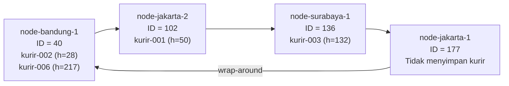
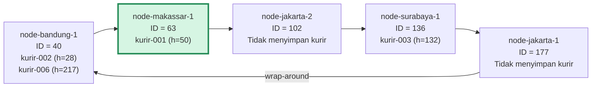
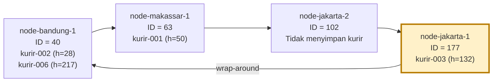

# Tugas 6 (Pekan 6) — Penamaan & Resolusi Lokasi

## 1. Kurir FoodGo Menggunakan Location-Independent Identifier dibanding alamat IP langsung
Karena dalam operasional FoodGo, kurir terus berpindah lokasi fisik, sehingga alamat jaringan perangkat kurir selalu berubah ubah.

Jika modul penugasan FoodGo memanggil kurir menggunakan alamat IP secara langsung, maka setiap kali IP kurir berubah, identitas kurir akan terpututs dari sistem. Oleh karena itu, diterapkan pemisahan antara Name/identifier (Ex: kurir-001, kurir-002) yang bersifat location-independent dan address (Ex: 192.168.1.10, 172.16.5.77) atau lokasi jaringan asli tempat paket data harus dikirimkan saat itu.

Dengan arsitektur ini, ketika kurir-001 berganti jaringan dari 192.168.1.10 menjadi 172.16.5.77, nilai hash identitasnya tetap sama yaitu h=50 dan tetap dicari pada node yang sama yaitu node-makassar-1(id=63). Modul lain cukup melakukan lookup berdasarkan ID kurir-001 tanpa perlu tahu perubahan IP di balik layar.
## 2. Diagram Ring Topology Chord DHT FoodGo

Simulasi menggunakan ruang hash 8-bit (0–255). Node diurutkan menurut ID hash dan dihubungkan secara melingkar searah jarum jam. Sesuai aturan Chord, setiap key kurir ditempatkan pada node pertama yang ID-nya lebih besar atau sama dengan nilai hash kurir tersebut (*successor*). Jika tidak ada node dengan ID yang cukup besar, pencarian berputar ke node ber-ID paling kecil (*wrap-around*).

### A. Ring awal (4 node)



Pada kondisi awal, `kurir-002 (h=28)` dan `kurir-006 (h=217)` menjadi tanggung jawab Bandung (id=40); `kurir-001 (h=50)` menjadi tanggung jawab Jakarta-2 (id=102); dan `kurir-003 (h=132)` menjadi tanggung jawab Surabaya (id=136). Kurir-006 menggunakan *wrap-around* karena hash 217 lebih besar daripada ID node terbesar, yaitu 177.

### B. Ring setelah node Makassar bergabung (5 node)



Saat Makassar (id=63) bergabung di antara Bandung (id=40) dan Jakarta-2 (id=102), hanya `kurir-001 (h=50)` yang berpindah dari Jakarta-2 ke Makassar. Kurir lainnya tetap berada pada node sebelumnya.

### C. Ring setelah node Surabaya keluar (4 node)



Setelah Surabaya (id=136) keluar, `kurir-003 (h=132)` berpindah ke Jakarta-1 (id=177) sebagai *successor* berikutnya. Mapping untuk kurir-001, kurir-002, dan kurir-006 tetap pada node sebelumnya.

## 3. Analisis saat node baru bergabung dan node keluar
Keunggulan utama consistent hashing pada DHT FoodGo dibanding hashing konvensional adalah minimalisasi perpindahan data ketika jumlah server berubah. Pada hash % N, menamabahi atau mengurangi 1 server akan mengubah hasil modulo hampir seluruh key. Sebaliknya pada pengujian DHT ini:

### 1. Skenario node join (node-makassar-1 masuk dengan id=63):
node-makassar-1 (id=63) menyisip di antara node-bandung-1 (id=40) dan node-jakarta-2 (id=102).Ia mengambil alih tanggung jawab rentang hash (40, 63].Dari 4 kurir yang terdaftar, hanya 1 key yang berpindah, yaitu kurir-001 (h=50) yang bergeser dari node-jakarta-2 (id=102) ke node-makassar-1 (id=63) karena 50 kurang dari 63. Tiga key lainnya (kurir-002, kurir-003, kurir-006) sama sekali tidak terganggu dan tetap berada di node masing-masing.

### 2. Skenario Node Leave (node-surabaya-1 dengan id=136 keluar):
Ketika node-surabaya-1 (id=136) keluar dari ring, tanggung jawab rentang hash miliknya otomatis dilimpahkan ke successor berikutnya searah jarum jam, yaitu node-jakarta-1 (id=177). Terlihat pada log, hanya key milik node yang keluar yang dipindahkan, yaitu kurir-003 (h=132) berpindah dari node-surabaya-1 (id=136) ke node-jakarta-1 (id=177). Key di node Bandung dan Makassar tidak mengalami perubahan.

### 3. Skenario Update Mapping IP (kurir-001 berganti IP):
Ketika kurir-001 (h=50) memperbarui alamat IP-nya dari 192.168.1.10 ke 172.16.5.77, operasi REGISTER langsung menimpa (overwrite) nilai alamat di node-makassar-1 (id=63) tanpa mengubah posisi penyimpanan key di dalam ring.


**Materi terkait:** Flat Naming, Structured Naming (DNS), Distributed Hash Table (DHT)/Chord.

## Studi Kasus

Pelanggan FoodGo kesulitan menemukan alamat IP server kurir yang **dinamis** (kurir berpindah lokasi/jaringan, IP-nya sering berubah). FoodGo butuh cara memetakan **ID Kurir** (identitas tetap) ke **alamat IP terkininya** tanpa server pusat tunggal yang jadi bottleneck/single point of failure.

## Tugas Kelompok

Implementasikan **simulasi Chord DHT** sederhana (single-process, tidak perlu jaringan sungguhan — cukup simulasi struktur data & algoritma di satu program Python) yang memetakan ID Kurir ke alamat IP mereka.

Konsep yang harus terlihat jalan dalam simulasi kalian:
1. **Consistent hashing**: ID Kurir dan ID Node di-hash ke ruang angka yang sama (mis. 0–255 untuk kesederhanaan, `m=8` bit).
2. **Ring topology**: node-node diurutkan melingkar berdasarkan hasil hash-nya.
3. **Lookup**: fungsi `lookup(kurir_id)` yang menemukan node mana yang bertanggung jawab menyimpan mapping ID Kurir tersebut → alamat IP-nya (aturan Chord: node dengan ID hash **terkecil yang lebih besar atau sama dengan** hash key, disebut *successor*).
4. **Perubahan topologi**: simulasikan minimal satu node baru bergabung (`join`) atau satu node keluar (`leave`), tunjukkan bagaimana mapping berpindah tanggung jawab ke node lain.

Skeleton disediakan di `src/chord_simulation.py` dengan fungsi hashing dan struktur ring sudah ada — bagian `lookup()`, `join()`, dan `leave()` sengaja dikosongkan.

### Cara Menjalankan

```bash
python3 src/chord_simulation.py
```

## Tugas Analisis (`README.md`)

1. Jelaskan **kenapa DHT/Chord** lebih cocok untuk kasus ini dibanding **flat naming sederhana** (mis. tabel pusat ID→IP) atau **DNS konvensional** — kaitkan dengan sifat "IP kurir sering berubah" dan kebutuhan tanpa titik gagal tunggal.
2. Gambarkan (boleh pakai Mermaid, lihat Tugas 2) ring topology dari simulasi kalian, tandai node mana yang bertanggung jawab atas ID Kurir mana.
3. Jelaskan apa yang terjadi pada mapping saat sebuah node **keluar** dari ring (siapa yang mengambil alih tanggung jawabnya) — dukung dengan output program.

## Struktur Submission

```
tugas-06-penamaan-dht/
├── README.md      # Analisis + diagram ring
├── JURNAL.md
├── src/
│   └── chord_simulation.py
└── bukti/          # Output program (screenshot/log) untuk skenario join & leave
```

## Rubrik Penilaian (Tugas 6)

| Komponen | Bobot | Kriteria |
|---|---|---|
| Implementasi lookup/join/leave benar | 35% | Consistent hashing & successor lookup sesuai aturan Chord |
| Bukti perubahan topologi (join/leave) | 25% | Output menunjukkan mapping berpindah dengan benar |
| Analisis kenapa DHT vs flat naming/DNS | 25% | Argumen spesifik ke kasus IP kurir dinamis, bukan definisi umum |
| Proses & kontribusi kelompok | 15% | `JURNAL.md`, commit history |

## Batasan Penggunaan AI (Level 2)

Kebijakan **Level 2 (AI Assisted Idea Generation & Structuring)** berlaku — lihat [`../RUBRIK-UMUM.md`](../RUBRIK-UMUM.md). Boleh bertanya konsep umum consistent hashing/Chord ke AI; **tidak boleh** meminta AI menuliskan isi `# TODO` di `src/chord_simulation.py` (`find_successor`, `join`, `leave`, dst). Catat pemakaian AI di "Log Penggunaan AI" pada `JURNAL.md`.

- `README.md` wajib menelusuri manual (langkah demi langkah) bagaimana `lookup()` menemukan successor untuk salah satu ID Kurir contoh yang dipakai di `chord_simulation.py` — bukan cuma menempelkan output program.
