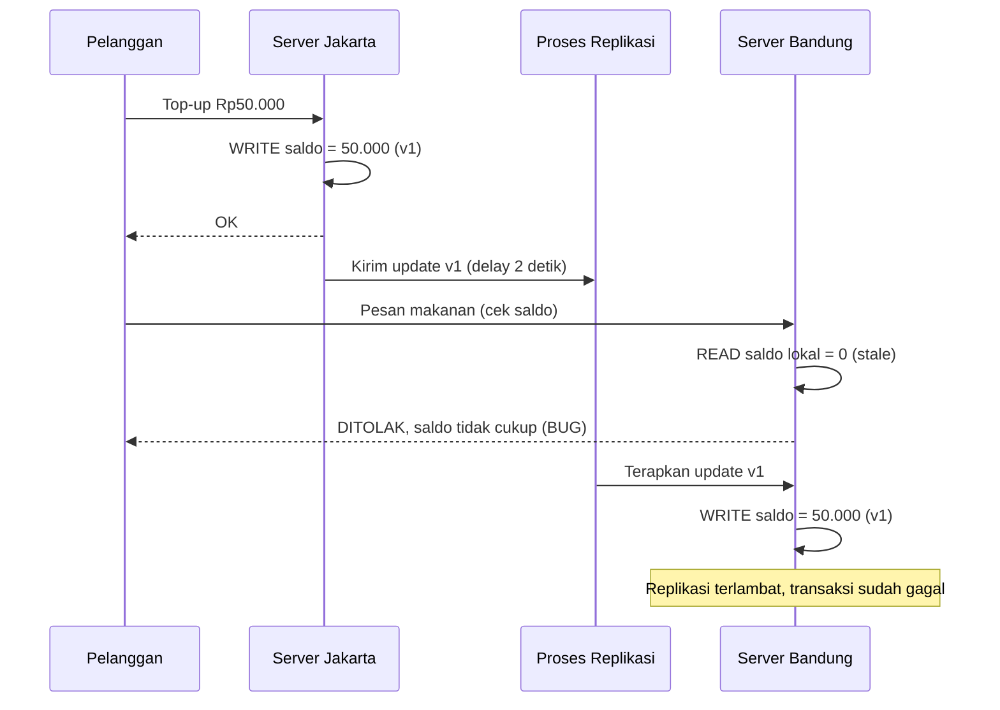
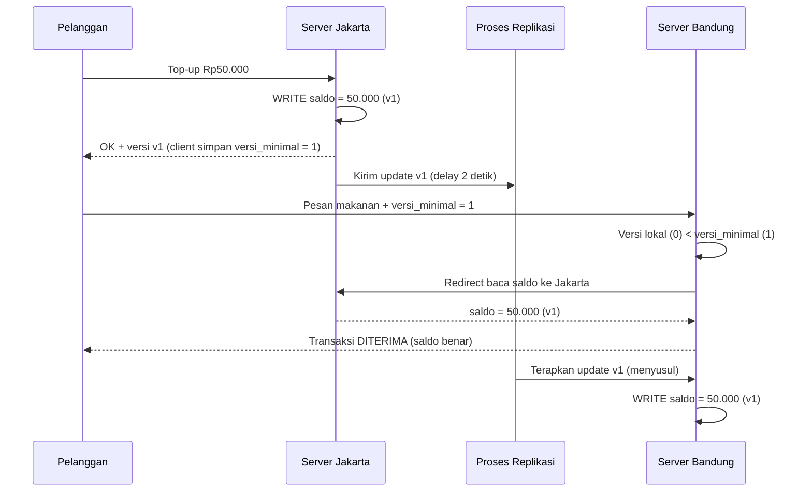

# Tugas 7 (Pekan 7) — Konsistensi Data

**Materi terkait:** Data-Centric Consistency (Sequential, Eventual), Client-Centric Consistency.

## Studi Kasus

Data saldo *e-wallet* pelanggan FoodGo berbeda antara server wilayah **Jakarta** dan **Bandung** karena replikasi antar server berjalan lambat. Contoh kasus nyata: pelanggan top-up saldo lewat server Jakarta, lalu dalam hitungan detik memesan makanan lewat aplikasi yang tersambung ke server Bandung — saldo belum ter-update, transaksi ditolak padahal saldo sebenarnya cukup.

## Tugas Kelompok

### Bagian 1 — Analisis (wajib)

1. Tentukan: apakah kasus ini **membutuhkan Sequential Consistency** (semua replika melihat urutan operasi yang sama) atau **cukup Eventual Consistency** (replika akan konsisten "pada akhirnya", boleh sementara berbeda)? Berikan argumen berbasis dampak bisnis (mis. kasus saldo *e-wallet* jauh lebih sensitif dibanding kasus "jumlah like" di media sosial).
2. Jika kalian menyimpulkan Eventual Consistency saja **tidak cukup** untuk skenario ini, usulkan pendekatan **Client-Centric Consistency** yang relevan (mis. *Read-Your-Writes*: pelanggan yang baru top-up harus selalu melihat saldo terbarunya sendiri, walau replika lain belum sinkron).
3. Gambarkan **diagram alir urutan (sequence diagram)** yang menunjukkan operasi read/write antara pelanggan, server Jakarta, server Bandung, dan proses replikasi — untuk skenario **tanpa** jaminan konsistensi (bug terjadi) DAN skenario **dengan** solusi yang kalian usulkan (bug teratasi). Pakai Mermaid (`sequenceDiagram`) di `README.md` — lihat contoh cara pakai di Tugas 2.


## 1. Apakah kasus saldo E-Wallet FoodGo membutuhkan sequential consistency atau cukup eventual consistency?
Untuk kasus saldo e-wallet dan transaksi pembayaran pada aplikasi FoodGo, Eventual Consistency saja tidak cukup dan berisiko tinggi merusak bisnis. Sistem ini membutuhkan jaminan konsistensi yang lebih kuat seperti Client-Centric Consistency atau Sequential/Linearizability pada tingkat akun pengguna.

### Kenapa eventual consistency berbahaya untuk saldo E-Wallet?
Karena Eventual Consistency hanya menjamin bahwa semua replika server (misal Jakarta dan Bandung) akan menjadi konsisten "pada akhirnya" (eventually) jika tidak ada operasi tulis baru dalam jangka waktu tertentu. Namun, dalam jeda waktu sebelum replikasi selesai (replication lag), data antar server akan berbeda (stale data).

### Analisis dampak bisnis
Berbeda dengan kasus "jumlah like" atau "komentar" di media sosial yang mana keterlambatan sinkronisasi selama beberapa detik tidak menimbulkan kerugian finansial atau hukum kasus saldo e-wallet menyangkut aset keuangan riil. Jika pelanggan melakukan top up di server Jakarta lalu dalam hitungan detik memesan makanan melalui server Bandung yang belum menerima data terbaru, transaksi pelanggan akan ditolak karena saldo terbaca Rp0. Hal ini memicu false rejection, menurunkan user experience secara drastis, hilangnya kepercayaan pelanggan (customer churn), serta potensi kerugian komersial bagi merchant FoodGo.

## 2. Mengapa Read-Your-Writes menjadi solusi yang relevan?
Karena penerapan Sequential Consistency global di seluruh pusat data geografis (Jakarta, Bandung, dll.) akan memicu latensi jaringan yang sangat tinggi setiap kali ada transaksi karena harus menunggu semua server di seluruh wilayah mengonfirmasi data secara bersamaan, solusi yang paling realistis dan efisien untuk arsitektur geo distributed adalah menggunakan Client-Centric Consistency, khususnya model Read-Your-Writes Consistency.

### Definisi & cara kerja Read-Your-Writes
Model ini menjamin bahwa proses tulis (write) yang dilakukan oleh seorang klien tertentu akan selalu dapat dibaca oleh klien yang sama pada akses baca (read) berikutnya, terlepas dari server mana ia terhubung, bahkan jika replika lain di wilayah tersebut belum melakukan sinkronisasi.

## Implementasi teknis pada FoodGo
Ketika pelanggan melakukan top up saldo di server Jakarta, server tersebut menghasilkan nomor versi transaksi (version number atau timestamp). Saat merespons sukses top up ke aplikasi ponsel pelanggan, server Jakarta mengirimkan metadata versi tersebut (misal: version = 1). Ketika pelanggan melakukan checkout makanan (walaupun terhubung ke server Bandung), aplikasi ponsel menyertakan parameter versi minimal tersebut (versi_minimal = 1). Server Bandung memeriksa versinya sendiri, jika versi data lokal < versi_minimal, server Bandung akan melakukan redirect pembacaan langsung ke server Jakarta atau menunggu hingga data terbarunya tersinkronisasi. Dengan cara ini, pelanggan dijamin tidak akan pernah melihat saldo lamanya sendiri.

## 3. Sequence Diagram

### a) Tanpa jaminan konsistensi (bug terjadi)



### b) Dengan Read-Your-Writes (bug teratasi)



### Bagian 2 — Simulasi (opsional, nilai tambah)

Skeleton `src/replica_simulation.py` mensimulasikan dua replika (Jakarta & Bandung) dengan delay replikasi buatan. Lengkapi TODO untuk:
1. Menunjukkan kondisi **inconsistent read** (replika Bandung masih menunjukkan saldo lama walau Jakarta sudah update).
2. Mengimplementasikan mekanisme **Read-Your-Writes** sederhana (mis. dengan version/timestamp per client) yang memperbaiki masalah tersebut.

```bash
python3 src/replica_simulation.py
```

## Struktur Submission

```
tugas-07-konsistensi-data/
├── README.md      # Analisis konsistensi + sequence diagram Mermaid
├── JURNAL.md
├── src/            # (opsional) simulasi replikasi
└── bukti/          # (jika mengerjakan simulasi) output program
```

## Rubrik Penilaian (Tugas 7)

| Komponen | Bobot | Kriteria |
|---|---|---|
| Ketepatan pemilihan model konsistensi | 30% | Argumen berbasis dampak bisnis nyata, bukan hafalan definisi |
| Kualitas sequence diagram | 30% | Menunjukkan jelas titik kegagalan & titik perbaikan |
| Usulan solusi client-centric | 25% | Solusi konkret dan dapat diimplementasikan (bukan wacana abstrak) |
| Proses & kontribusi kelompok | 15% | `JURNAL.md`, commit history (+ bonus jika simulasi dikerjakan) |

## Batasan Penggunaan AI (Level 2)

Kebijakan **Level 2 (AI Assisted Idea Generation & Structuring)** berlaku — lihat [`../RUBRIK-UMUM.md`](../RUBRIK-UMUM.md). Boleh bertanya konsep umum consistency model ke AI untuk brainstorming; **tidak boleh** meminta AI menuliskan analisis akhir/sequence diagram atau isi `# TODO` di `src/replica_simulation.py` yang tinggal ditempel. Catat pemakaian AI di "Log Penggunaan AI" pada `JURNAL.md`.

- Sebagai bukti pemahaman konsep (bukan hafalan jawaban skenario FoodGo saja), `README.md` wajib menyertakan **satu skenario tambahan** yang kalian buat sendiri (mis. kasus lain di aplikasi ojek online) dan menentukan model konsistensi yang tepat untuk skenario tambahan tersebut.
